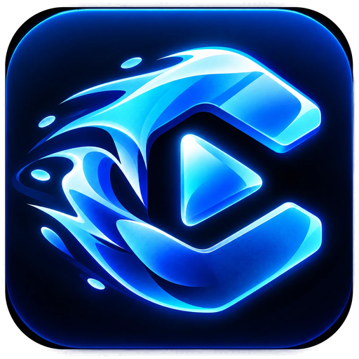

<p align="center">
  
</p>

<h1 align="center">Clutch</h1>
<p align="center"><b>The game clip recorder you can tell what to clip.</b><br>
Free and open source for Windows. Lightweight like NVIDIA's recorder, social like Medal, no ads you can't turn off.</p>

---

## Features

**Recording**
- Always-on **replay buffer** (GPU encoded: NVENC, AMF or Quick Sync). Frames go from screen to encoder without leaving the GPU.
- **Clip hotkey** saves the last few seconds plus a few after. **Change the length in game** with Alt+PageUp / Alt+PageDown, or give extra hotkeys their own length.
- **Long recording** (Alt+F9) for whole sessions, with **bookmarks** (Alt+F8) that turn into clips in one click.
- **Choose what to record:** full screen, the game's window, any app window, or a custom area you drag on screen (with 16:9-on-ultrawide presets).
- **Audio sources** like OBS, made simple: several mics or virtual cables plus game audio, each with its own volume, and optional **separate tracks** in every clip.
- Picks **HEVC/AV1 automatically** on screens wider than 4096 px. Quality presets, 30–144 fps, resolution scaling.

**Clips that make themselves**
- **Hype moments** (no AI): clips when you or your friends suddenly get loud.
- **When people talk** (no AI): saves every stretch of conversation.
- **Watch the screen** (optional AI): describe what to clip in plain English, e.g. "my kills and goals, never menus".
- **Game detection** starts recording when a game opens, tags clips with the game's icon, and supports **per-game profiles**.
- **Clip of the day**, picked without AI and optionally posted to Discord.

**Library and sharing**
- Library with game strip, hover previews, search, favorites, tags, multi-select, trash with undo.
- Viewer with drag-to-scrub timeline, trim handles, bookmarks and keyboard shortcuts.
- **Discord** posting through a webhook, with automatic Discord-sized copies that play inline.
- **YouTube** uploads, now or scheduled, plus an auto-upload schedule.
- **Share links** (Clutch account): a watch page anyone can open, which also plays inline in Discord.
- **Universal search** (Ctrl+K) for settings, clips, games and actions.

**Desktop**
- Liquid-glass interface with a light HUD style, optional Windows 11 acrylic window, Lite mode for older GPUs.
- Lives in the system tray, starts with Windows, shows an on-screen "Clipped!" popup.

## Install

Download `Clutch-Setup-x.y.z.exe` from [Releases](../../releases). Windows 10 or 11 and a GPU from the last few generations are recommended.

## Build from source

```bash
npm install
npm run dev                                   # hot reload
npm run build && npx electron .               # production build, unpacked
pwsh scripts/fetch-ffmpeg.ps1                 # bundle FFmpeg (or -FromPath to copy yours)
npm run dist                                  # installer in release/
```

Development needs Node 22+ and `ffmpeg`/`ffprobe` on `PATH` (a "full" build with `ddagrab`, for example `winget install Gyan.FFmpeg`).

## Free, Pro and sponsored cards

Everything that runs on your PC is free, with no limits on recording, triggers, the editor, Discord or manual YouTube uploads.
An optional Clutch account adds cloud features, and **Clutch Pro** pays for the cloud:

| | Free | Pro |
|---|---|---|
| Cloud storage | 2 GB | 100 GB |
| Share links | Kept 30 days | Never expire |
| Auto-upload schedule | 1 time a day | Up to 12 a day |
| Cloud backup of favorites | – | Automatic |
| Sponsored cards | Optional, one switch in Settings | Never |

Sponsored cards appear only on the Home and Clips pages, never in game, and carry no tracking.
They come from `server/ads.json`.

## Cloud server

`server/` is the small backend for sign-in (Discord, Google/YouTube, Twitch), cloud storage, share
links, Stripe subscriptions and the sponsored-card feed. It has no npm dependencies. See
[server/README.md](server/README.md). Builds point at `OFFICIAL_CLOUD_URL` in `src/shared/types.ts`;
anyone can point their app at a self-hosted server under Settings → Account.

## How capture works

```
screen (ddagrab, on the GPU) ──────┐
mics / virtual cables (dshow) ─────┤
system audio (WASAPI loopback) ────┼─► one FFmpeg process ─► 2-second MPEG-TS segments (ring buffer)
one app, e.g. Discord (per-process ┘
  loopback, own track)
AI screen watching (optional): small frames taken from finished segments in a separate process
```

Saving a clip stitches segments with stream copy, so it is instant and never re-encodes. Track 1 is
always the mix; separate tracks follow it and are named in the MP4.

### Measure it yourself

`node scripts/benchmark.mjs 60` while Clutch records adds up every Clutch process (app, FFmpeg,
helpers) and saves CPU, memory and NVENC load to a JSON file. Please share yours with your CPU,
GPU and resolution: numbers from common cards (RTX 3060 / RX 6600 class at 1080p) are the most
useful. Reference run (RTX 5090, 32 threads, 5120x1440 at 60 fps, main window open, plus a
Discord-only track):

| Process | CPU (whole PC) | RAM |
|---|---|---|
| Clutch app (5 processes) | 0.8% | 660 MB |
| FFmpeg (recording) | 0.7% | 190 MB |
| Helpers (game detection, app audio) | <0.1% | 175 MB |
| NVENC encoder | 18% | |

Background work (exports, Discord copies, thumbnails, text reading, game detection) runs below
normal priority; only the live recording stays at normal so it never drops frames.

## Project layout

```
src/main/        Electron main process: capture, triggers, library, uploads, cloud account, tray
src/preload/     the bridge the UI talks through (window.cf)
src/renderer/    React + Tailwind UI
src/shared/      types and settings shared by both sides
server/          optional cloud server (Node; only dependency is the Anthropic SDK for smart read)
scripts/         icon import, FFmpeg fetch
```

## Contributing

Bug reports, ideas and pull requests are welcome. See [CONTRIBUTING.md](CONTRIBUTING.md).

## License

Clutch is free software under the **GNU General Public License v3.0 or later**: see [LICENSE](LICENSE).
Bundled FFmpeg builds are GPL as well; see [THIRD_PARTY_NOTICES.md](THIRD_PARTY_NOTICES.md).
